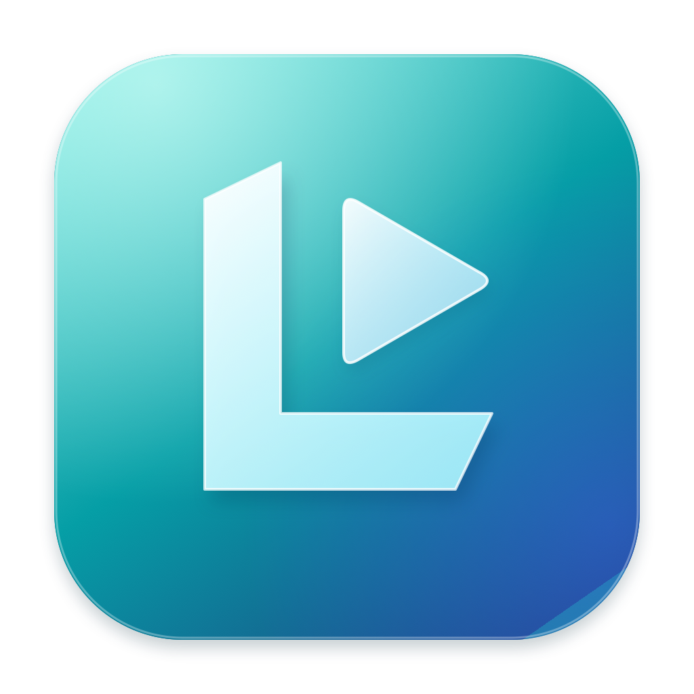
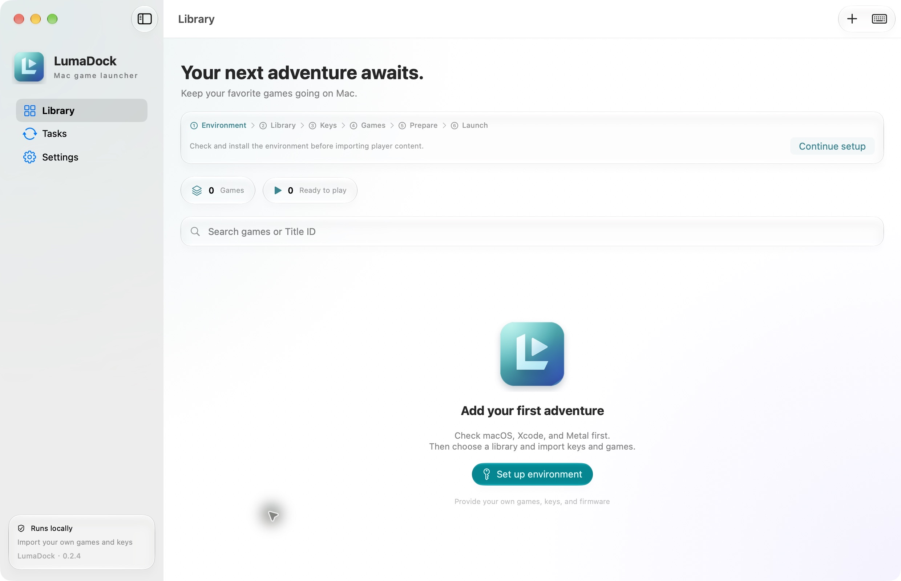
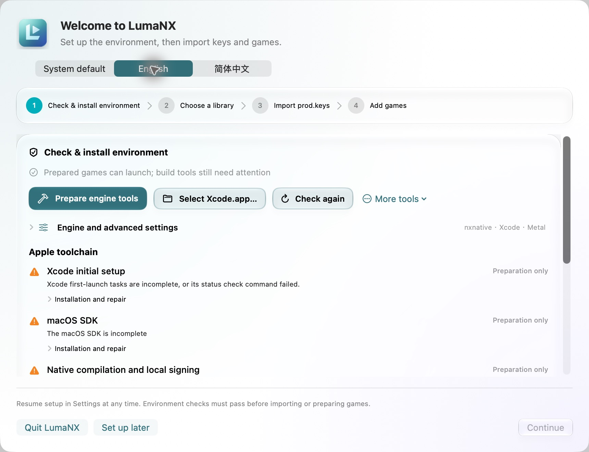
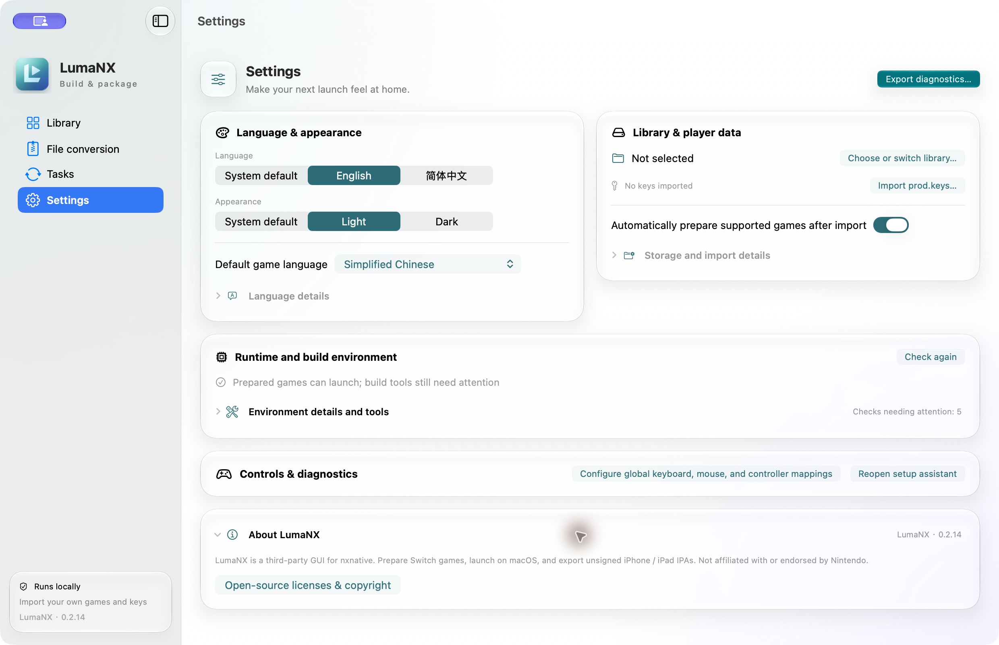

  

<h1 align="center">LumaDock · 璃游</h1>

Let your games continue on Mac.

<strong>English</strong> · <a href="README.zh-CN.md">简体中文</a>

Apple Silicon · macOS 26+ · SwiftUI / Liquid Glass

<a href="https://github.com/Xc1Ym/LumaDock/releases/latest">Download for Mac</a> · <a href="https://github.com/Xc1Ym/LumaDock/actions/workflows/ci.yml">Build status</a>

LumaDock is a native Switch game launcher for Apple Silicon Macs. With your own **[nxnative](https://github.com/seedds/nxnative) engine**, authorized NSP files and `prod.keys`, import games, prepare and launch them on Mac, or export an unsigned iPhone / iPad IPA.

nxnative provides native execution and Metal graphics; LumaDock provides the library and graphical workflow. **No engine, games, updates, DLC, firmware, keys, game artwork or player caches are included or offered for download.**

## Features

- **Library management** — Import or scan NSPs; match base games, updates and DLC by content metadata.
- **Automated builds** — Prepare code, shaders and runtime files with validated caches, cancellation and retry.
- **File conversion** — Convert NSP/XCI, compress or decompress NSZ/XCZ, and merge packages using bundled conversion tools adapted from [SAK-Mac](https://github.com/ggaoph-lab/SAK-Mac). Exported NSPs can be imported into the library.
- **IPA export** — Generate an unsigned iPhone / iPad package from game details.
- **Visible progress and errors** — Follow measured progress, milestone steps and reference time estimates; get shader warnings, repair suggestions, specific logs and redacted error summaries.
- **Native Mac experience** — English / 简体中文, light / dark appearance, game-language settings and input mapping where supported by the selected engine.

## Get started

**Requirements:** Apple Silicon and macOS 26+. Preparing games also requires full Xcode with Metal and a compatible external nxnative source directory. The initial engine-tool build also needs the **.NET 10 SDK for macOS Arm64**. Generic runtime dependencies are bundled.

1. Download the latest **ARM64 DMG**, verify `SHA256SUMS`, and drag **LumaDock.app** into Applications. Current builds use **ad-hoc signing and are not notarized**.
2. Follow setup: check the environment, select your nxnative source root, and choose **Prepare engine tools**.
3. Choose a library, import your own `prod.keys`, then add the base game, updates and DLC as NSP files.
4. Prepare the game and choose **Launch game**, or choose **Generate IPA…** in game details. Tasks show progress and support cancellation and retry.

IPA export additionally requires Xcode's **iOS platform** and **XcodeGen** (`brew install xcodegen`). Sign the exported IPA with your installation tool before installing it.

Compatibility depends on the selected engine and game version. Successful preparation does not guarantee full gameplay compatibility; iOS device compatibility has not been validated. **Back up saves before upgrades or experiments.**

## Screenshots

Light appearance with an empty library; no player data or game content.

Setup and Settings

## Documentation and help

| Guide | Contents |
| --- | --- |
| [Getting started](docs/Getting-started.md) | Setup, IPA export, input, language and data management |
| [Environment and repair](docs/Environment.md) | Dependencies, installation and toolchain troubleshooting |
| [Development](docs/Development.md) | Tests, local builds and CI releases |
| [Release notes](docs/RELEASE_NOTES.md) | Latest changes in English and Chinese |
| [Architecture](docs/架构说明.md) · [Engine interface](docs/引擎修改.md) · [Validation record](docs/验收记录.md) | Technical details and bounded test evidence (Chinese) |

For failures, open the task's log or copy its redacted error summary. [Report an issue](https://github.com/Xc1Ym/LumaDock/issues) with the app, chip, macOS and Xcode versions plus reproduction steps. Review diagnostics before sharing; never upload games, keys, firmware, saves or private caches.

## Acknowledgements and license

Special thanks to **[nxnative](https://github.com/seedds/nxnative)** for the core execution and graphics capabilities, and to **[MacNativeGames](https://github.com/ly05010419/MacNativeGames)** and **[d2r-mobile](https://github.com/jhaizhou-ops/d2r-mobile)** for their upstream contributions. File conversion adapts code from **[SAK-Mac](https://github.com/ggaoph-lab/SAK-Mac)** (MIT). The engine remains external. Thanks also to Ryujinx / Spv.Generator, LibHac, SPIRV-Cross, CPython, .NET and other dependencies; see the [full third-party notices](docs/Third-party-licenses.md).

Launcher code and original artwork use the **[MIT License](LICENSE)**; third-party components retain their own licenses. The software is provided “AS IS.” Use only content you are authorized to use. Nintendo and game trademarks belong to their respective owners; this project is not affiliated with or endorsed by Nintendo or any game publisher.
