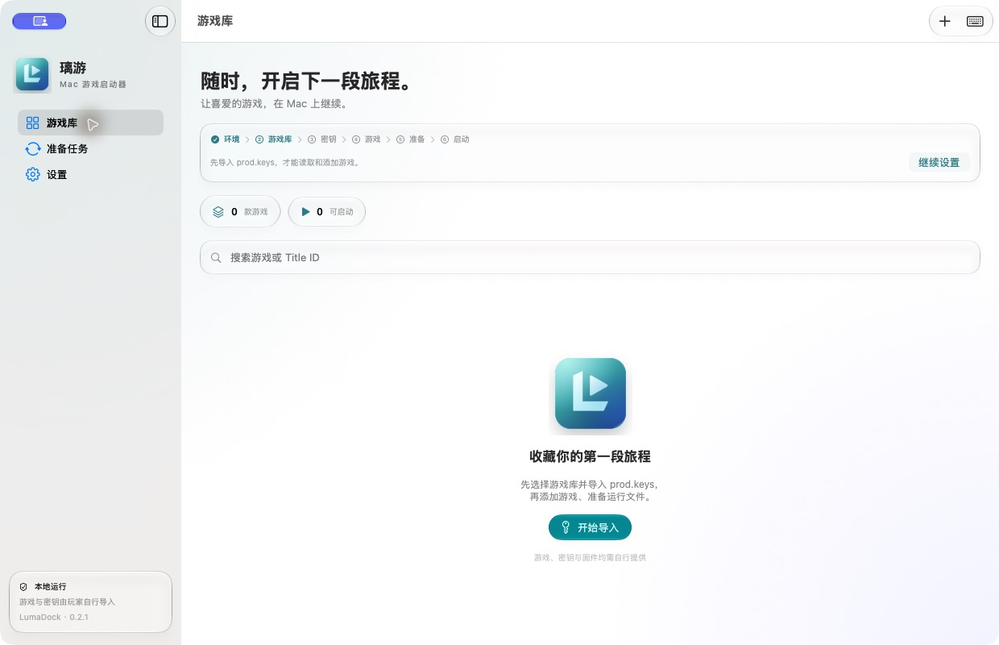
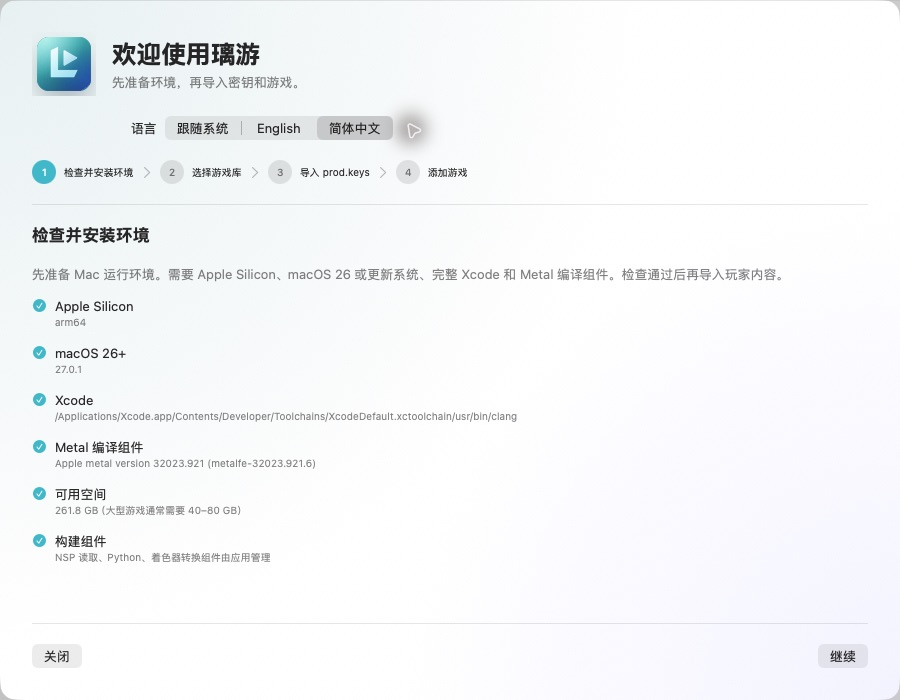
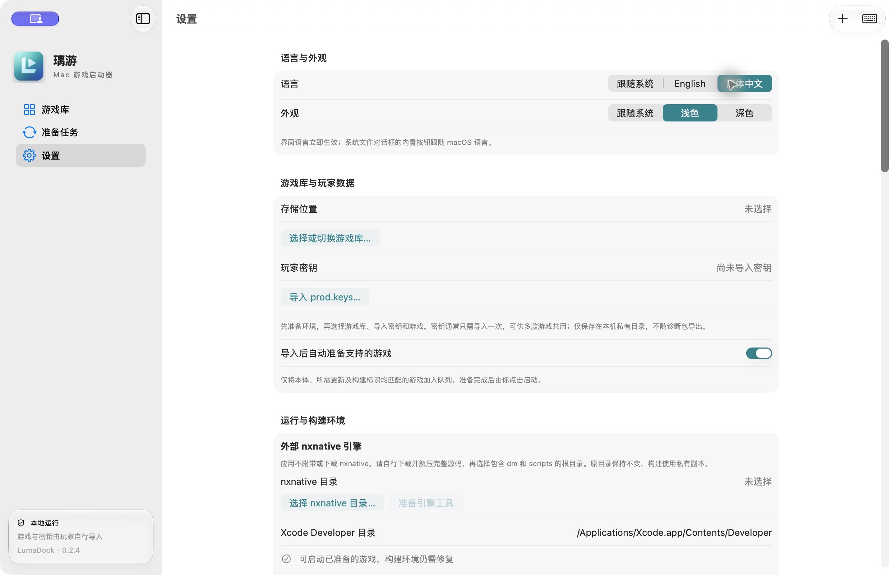

<p align="center">
  
</p>
<h1 align="center">璃游 · LumaDock</h1>
<p align="center">让喜爱的游戏，在 Mac 上继续。</p>
<p align="center"><a href="README.md">English</a> · <strong>简体中文</strong></p>
<p align="center">Apple Silicon · macOS 26+ · 原生 Liquid Glass 界面</p>
<p align="center"><a href="https://github.com/Xc1Ym/LumaDock/releases/latest">下载 Mac 版</a> · <a href="https://github.com/Xc1Ym/LumaDock/actions/workflows/ci.yml">构建状态</a></p>

璃游是专为 Apple Silicon Mac 开发的游戏启动器，基于 **[nxnative](https://github.com/seedds/nxnative)**。带上你有权使用的游戏 NSP 文件和 `prod.keys`，在图形界面里导入、准备并启动游戏。

游戏通过 nxnative 的代码重写与运行时，在 Apple Silicon 上原生执行，图形由 Metal 呈现。璃游负责整理游戏库和调度这些步骤，直接生成 macOS 运行文件。

**项目不附带游戏、更新、DLC、固件、密钥、游戏封面或玩家生成的着色器缓存，与 Nintendo 及游戏发行商没有隶属关系。** 应用界面与 README 均支持**英文和简体中文**。界面默认跟随 macOS 语言，可在**设置 → 语言**或首次运行向导中选择“跟随系统 / English / 简体中文”，切换立即生效。系统对话框内置按钮及原始编译日志保留系统或工具语言。

可在**设置 → 语言与外观**中选择“跟随系统、浅色、深色”，独立控制璃游的显示风格，立即生效并记住选择。

游戏详情可选择**启动语言**；**设置 → 游戏语言 → 默认游戏语言**控制未单独设置的游戏，初始默认为简体中文。游戏语言与启动器界面语言独立，下次启动游戏时生效，无需重新准备或导入固件。可用语言取决于游戏自身支持。

**应用、DMG 和源码包均不包含 nxnative，也不提供引擎下载按钮或自动下载。请玩家自行获取并解压完整源码，再在首次设置或设置中选择根目录。**

## 功能

- **外部引擎。** 验证所选目录和接口，在私有缓存中准备读取工具；原源码不变，源码内容指纹隔离不同引擎的构建。

- **一个游戏库**：导入 NSP 或扫描文件夹，按内容元数据识别本体、更新和 DLC，支持拖入、多选、中文路径及重复文件检查。
- **自动准备**：解包、合并更新、处理 DLC、重写代码、转换并编译着色器，再构建 Mac 主程序。提供阶段进度、取消、缓存校验和重试。
- **一键生成 IPA**：在游戏详情中导出 iPhone / iPad 的未签名游戏包，自动编译 iOS 着色器和应用，完成后在访达中显示。
- **具体错误与修复建议**：构建失败显示阶段、错误原因、退出码及对应日志，支持复制脱敏摘要；部分着色器失败会明确显示警告，复用缓存后仍保留。
- **全流程进度条**：导入、引擎准备、游戏/着色器构建、IPA 导出、检查、组件管理、清理及诊断共用线形进度条，覆盖任务页、向导、设置和全局任务提示。已知总量显示实际百分比；未知总量显示运行状态、计数与已用时间。
- **原生 Mac 界面**：SwiftUI / AppKit、Liquid Glass、明暗外观，以及“减少透明度”的不透明回退。
- **独立保存玩家数据**：原始文件、托管副本、运行文件、缓存和存档分开管理；准备失败时保留上次成功版本。

## 界面截图

截图均使用浅色外观和空游戏库，不包含游戏画面、封面、密钥或玩家数据。

**游戏库** — 由玩家自行导入内容，应用不附带游戏。



**首次运行向导** — 先检查环境，再导入密钥与游戏。



**设置** — 切换界面语言，管理本地环境。



## 已在 Mac 测试的游戏

以下为此前内置引擎版本的历史测试，不代表任意外部 nxnative 源码已经通过验证。

**本 README 仅列出实际在 Mac 上测试过的游戏。** 测试记录日期为 2026 年 10 月 20 日，环境为 Apple M5 Pro、macOS 27.0.1、Xcode 27.1。

| 游戏 | 实测版本 | 结果与范围 |
| --- | --- | --- |
| 塞尔达传说 旷野之息 | 1.9.0 | **构建及启动通过**：含两个 DLC 的完整准备流程及短时原生运行通过，未验证完整游戏流程 |
| 超级马力欧 奥德赛 | 1.4.1 | **实际游玩测试通过**：完整准备及图形界面启动通过；玩家在约 23 分钟的运行中反馈正常游玩，已生成存档文件 |

以上结果均不代表通关验证。《奥德赛》仍有 3 个雷电效果几何着色器的已知转换缺口，相关效果及后续全部场景尚未完整检查。证据和未测范围见 [验收记录](docs/验收记录.md)。

导入时请提供本体、指定更新及需要使用的 DLC。Title ID 和程序构建标识必须匹配所选引擎的游戏配置；应用会在准备前检查所需内容。

《奥德赛》的玩家游玩记录基于此前的 `10b33338` 引擎。在更新后的 `4e2dcdc` 引擎上，《奥德赛》完整准备通过；《旷野之息》重建按玩家要求取消，未执行新版游戏启动检查。新版引擎的实际游玩尚未重新验证，也不增加其他游戏的兼容性声明。

## 开始使用

需要 **Apple Silicon Mac、macOS 26 或更新系统，以及完整 Xcode 和 Metal 编译组件**。当前实测环境为 M5 Pro、macOS 27.0.1、Xcode 27.1；macOS 26 真机尚未重新验收。大型游戏请预留数十 GB 空间，实际用量随游戏及缓存变化。

**1. 安装璃游。** 打开 `LumaDock-0.2.6-arm64.dmg`，将 `LumaDock.app` 拖入“应用程序”。当前安装包采用本地 ad-hoc 签名，尚未进行 Developer ID 签名和公证。首次打开如被系统拦截，请先核对来源和 `SHA256SUMS`，再使用系统“隐私与安全性”提供的打开流程。

**2. 先检查并安装环境。** 向导第一步检查 Apple Silicon、macOS、完整 Xcode、Metal、应用组件与可用空间。Xcode 按钮直接打开其 [Mac App Store 页面](https://apps.apple.com/app/xcode/id497799835)。缺少 Apple 工具时按步骤安装，再重新检查；全部通过后才能继续。Metal 组件可按 [Apple 官方方式](https://developer.apple.com/documentation/xcode/downloading-and-installing-additional-xcode-components) 安装。通用 Python、扩展、.NET 运行时、SPIRV-Cross 和 Zstandard 随应用提供。nxnative 及其翻译器由玩家提供：选择包含 `dm` 和 `scripts` 的源码根目录，再点击“准备引擎工具”。首次编译读取工具需要官方 **.NET 10 SDK（macOS Arm64）**，并可能从 NuGet 恢复 LibHac 依赖；已有完整缓存后不再需要 SDK。璃游不会下载或安装 nxnative。

**3. 选择游戏库、导入密钥，再添加游戏。** 按向导顺序操作。支持外置硬盘；准备和运行时请保持连接。先导入自己的 `prod.keys`，通常只需导入一次，多款游戏可共用；导入时检查格式，读取游戏时验证解密能力。添加按钮、菜单和拖入入口会引导回尚未完成的设置步骤。点击“添加游戏”，选择本体、更新和 DLC 的 NSP 文件，或者包含它们的文件夹，也可以直接拖入。璃游按内容识别文件，文件名无需符合特定格式。文件会复制到托管游戏库，复制成功后移动原文件不影响该副本。

**4. 自动准备，再启动。** 默认在导入完成、所需文件和版本匹配且工具链检查通过后，将新导入的游戏加入准备队列。缺少内容会在详情中列出；缺少工具时先完成安装，再点击“准备运行文件”。重复导入不触发准备。“准备任务”显示当前阶段、可用计数和错误信息。成功后由你点击“启动游戏”，不会自动启动。可在设置或向导中关闭“导入后自动准备”。首次准备可能耗时较长；重试会校验并复用已完成阶段。

逐步说明、迁移已有《旷野之息》构建及数据管理见 [使用说明](docs/使用说明.md)。

[环境要求与修复方法](docs/环境要求.md) 列出全部依赖及安装步骤。首次设置实际验证内置 Python 与扩展、.NET、NSP 读取器、着色器工具、Xcode 初始化、macOS SDK、原生及 Metal 编译、游戏库存储权限。Python 缺失时由原生界面直接提示，不要求玩家另装系统 Python；仅构建所需的工具与已准备游戏的启动条件分别标明。

设置中可卸载当前 Xcode 支持管理的 Metal 编译组件。卸载通过 Apple 的组件管理接口执行，因其为共享组件，需要确认；游戏或准备队列运行时禁止安装和卸载，操作后重新检查状态。卸载不会删除游戏、密钥或存档，再次准备游戏前需重新安装组件。


## 存档与文件

### 生成 iPhone / iPad IPA

完成环境设置并导入匹配引擎配置的本体、更新和 DLC 后，在游戏详情点击 **生成 IPA…**，选择游戏库以外的保存位置即可开始。无需先生成 Mac 运行版本。生成任务显示在“准备任务”中，支持取消和失败重试；完成后自动显示导出文件，也可通过任务卡片再次在访达中打开。

首次使用需在所选 Xcode 中安装 **iOS 平台及 Metal 编译组件**，并安装 **XcodeGen**（`brew install xcodegen`）。这些是 IPA 导出的额外要求；缺失时会显示修复提示，不影响仅在 Mac 上准备和运行游戏。构建缓存磁盘建议预留至少导入 NSP 总大小的两倍加 10 GB，保存磁盘还需容纳最终 IPA。

Mac 与 iOS 使用独立的构建缓存。导出与游戏运行、其他构建任务互斥；请先等待准备队列结束。失败或取消会保留原有 IPA、Mac 运行版本与存档。首次升级后若提示引擎工具缓存失效，请在设置中重新“准备引擎工具”。

导出的是**未签名 IPA**，需使用自己的安装工具签名后安装。设备、系统版本、内存能力和游戏兼容性以所选 nxnative 源码为准；Mac 的历史游玩记录不代表 iPhone / iPad 验收。Mac 的键鼠映射不随 IPA 导出，iOS 操作由引擎提供。

### Mac 游戏库文件

| 所选游戏库内的路径 | 内容 |
| --- | --- |
| `sources/` | 导入 NSP 的托管副本 |
| `games/<Title ID>/current` | 上次成功准备的运行版本 |
| `games/<Title ID>/pso_user/` | 可复用的运行时图形管线记录 |
| `cache/` | 构建及着色器缓存 |
| `saves/<Title ID>/` | 存档；也可从游戏详情在访达中打开 |
| `mappings/` | 每游戏输入配置 |

密钥和启动器设置保存在应用私有目录 `~/Library/Application Support/NSMac`，密钥权限为 `0600`。从旧版 NS Mac 升级沿用同一目录和应用标识，请避免同时运行新旧版本。

“移出游戏库”只移除登记，保留文件和存档。删除托管 NSP 副本、清理缓存分别确认，均不删除原始文件或存档。**升级、迁移和试验性运行前，请单独备份存档。**

## 已知限制

任务报错时，可在提示中选择“查看失败任务”，查看修复建议并打开**对应日志文件**；“复制错误摘要”包含错误代码、失败阶段与经过脱敏的编译器输出。可以识别 Metal/SDK 缺失、着色器转换或编译失败、缓存链不匹配、空间或权限问题，以及可能的内存不足。原始日志保留在本地，分享前仍需自行检查。没有成功着色器时停止构建；部分失败则标记“完成（有警告）”，不能据此保证所有游戏场景的图形正常。

- 引擎接口可能变化，不完整或不兼容的目录会被拒绝。未实现 `DM_INPUT_CONFIG` 的外部引擎使用自己的默认操作，映射编辑器会明确提示。

- 不支持 Intel Mac、XCI / NSZ、通用模拟器后端、联网游戏、体感或震动。
- 首次进入新场景仍可能编译图形管线并出现卡顿；离线着色器处理不能消除所有首次卡顿。
- 适配中的游戏可能无法启动、存在画面或音频异常，或在后续场景崩溃。“准备完成”不是完整可玩保证。
- 准备队列串行执行，准备和游戏运行互斥。应用重启后的中断任务需要手动重试。

报告问题时请附应用版本、芯片、macOS / Xcode 版本、复现步骤及已脱敏的错误摘要。可从设置导出诊断包；分享前仍应检查私人路径等信息。**不要上传密钥、游戏、固件、存档、封面或玩家缓存。**

## 开发与构建

启动器使用 SwiftUI / AppKit，Python Worker 调度构建，运行引擎改为玩家指定的外部 nxnative 目录，不再内置源码或二进制。使用结构、接口检查及源码指纹替代原有固定内置版本。[架构说明](docs/架构说明.md) 与 [外部引擎接口](docs/引擎修改.md) 记录具体边界。

维护者需完整 Xcode、Homebrew，以及 PATH 中可用的 [.NET 10 SDK](https://dotnet.microsoft.com/en-us/download/dotnet/10.0)。以下命令在项目根目录执行；Xcode 位于其他位置时请调整 `DEVELOPER_DIR`：

```bash
export DEVELOPER_DIR=/Applications/Xcode.app/Contents/Developer
mkdir -p work
brew install python@3.14 spirv-cross zstd
"$(brew --prefix python@3.14)/bin/python3.14" -m venv work/python-venv
work/python-venv/bin/python -m pip install -r requirements-runtime.txt -r requirements-build.txt
work/python-venv/bin/python -B -m unittest discover -s tests -v
swift test --disable-sandbox --cache-path "$PWD/work/spm-cache" -c release
swift scripts/make_icons.swift
work/python-venv/bin/python -B scripts/bundle_runtime.py
work/python-venv/bin/python -B scripts/package.py
work/python-venv/bin/python -B scripts/source_archive.py
work/python-venv/bin/python -B scripts/verify_release.py
```

产物在 `release/`：应用、DMG、源码 ZIP、`SHA256SUMS` 和发行审计。发行构建不需要游戏或密钥。运行依赖的实际版本记录在应用内 `Runtime/versions.json`；Homebrew 与工具链版本随构建环境变化，目前不保证逐字节可复现。

[GitHub CI](.github/workflows/ci.yml) 在 main/master push、版本标签、PR 或手动触发时，使用 macOS ARM64 runner 执行测试、构建、ad-hoc 签名及打包校验，保留构建附件 14 天。与 `product.json` 匹配的版本标签（例如 `v0.2.6`）只在 Mac 构建及校验通过后自动上传 GitHub Release；普通分支和 PR 不发布。CI 不运行商业游戏，也不替代真实硬件验收。更多说明见 [发布准备](docs/发布准备.md)。

开发和私有测试使用忽略的 `work/`；`--data-root <目录>` 可隔离应用数据。不要提交 `work/`、`release/`、`Runtime` 或任何玩家数据。

## 来源与致谢

**特别感谢 [nxnative](https://github.com/seedds/nxnative) 的作者与贡献者。nxnative 是璃游的直接上游，提供核心的游戏执行与图形能力。** 同时感谢 MacNativeGames、d2r-mobile 及下列依赖项目的作者与贡献者，他们的工作使本启动器得以实现。

各上游项目的贡献与许可如下：

- **[nxnative](https://github.com/seedds/nxnative)**（MIT，Copyright © 2026 jhaizhou）：直接上游，提供原生执行、NSO 重写、系统服务运行时和图形转换等核心能力。璃游增加游戏库、图形化流程、Worker、输入配置和 Mac 发行工具；引擎及其许可证留在玩家选择的目录中，不随璃游再分发。
- **[d2r-mobile](https://github.com/jhaizhou-ops/d2r-mobile)**（MIT）：nxnative 原生执行方案的来源之一，见 [上游致谢](https://github.com/seedds/nxnative#acknowledgements)。
- **[MacNativeGames](https://github.com/ly05010419/MacNativeGames)**（MIT）：经 nxnative 引入部分图形及着色器改进，范围和许可证见 [上游第三方说明](https://github.com/seedds/nxnative/tree/main/dm/third_party) 及 [许可文件](https://github.com/ly05010419/MacNativeGames/blob/main/LICENSE)。
- **Ryujinx / Spv.Generator、[LibHac](https://github.com/Thealexbarney/LibHac)、[SPIRV-Cross](https://github.com/KhronosGroup/SPIRV-Cross)**：经上游使用其着色器翻译、NSP 内容读取和 SPIR-V 到 Metal 转换能力。
- **CPython、.NET、Capstone、lz4、fontTools、Zstandard** 及上游包含的其他组件：各自许可证随源码或运行环境保留，见 [第三方许可](docs/第三方许可.md)。

## 许可、版权与风险

启动器新增代码及原创图标采用 **[MIT License](LICENSE)**，第三方代码保留各自许可证。软件按 “AS IS” 提供，不保证兼容性、稳定性或特定用途的适用性；实验性运行可能造成崩溃或存档损失。

Nintendo、Nintendo Switch 及游戏名称、商标、封面和游戏内容归相应权利人所有。本项目与 Nintendo 或游戏发行商没有隶属、赞助或认可关系。开源代码许可不授予任何游戏、固件、密钥或商标的使用与再分发权利。

请确认导入文件的来源和使用权限，并遵守所在地法律及适用的平台条款。项目不提供上述内容的下载、密钥分享或获取渠道；拥有硬件或游戏不应被视为对所有提取、使用或再分发行为的授权。
